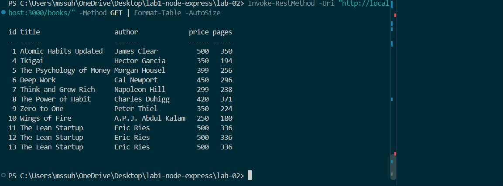
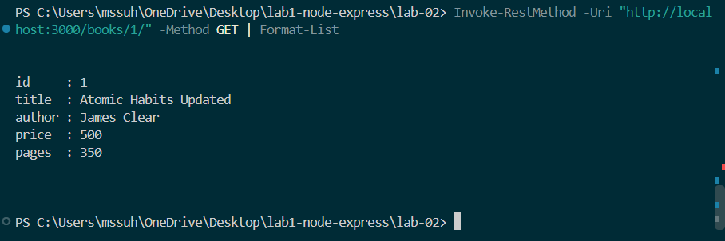
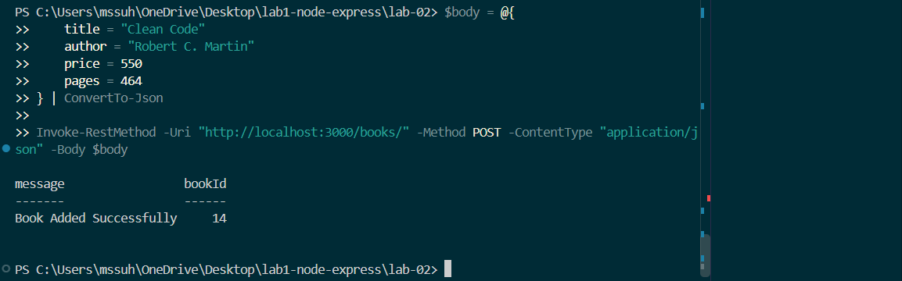
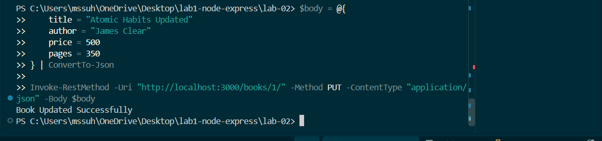
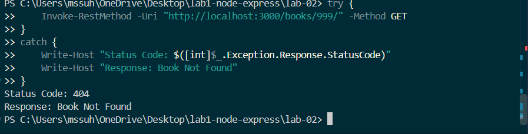

# Lab 2: SQLite Database and CRUD Routes

**Name:** Mohd Suhail
**Registration Number:** N25H03A0692
**Section:** [Enter your section]
**Course:** Backend Development Fundamentals
**University:** Aurora Deemed-to-be University
**Faculty:** Joel Prashanth D

## Objective

To connect an Express server with an SQLite database and implement CRUD operations using REST API routes.

## Installation and Execution

```bash
npm install
npm run dev
```

To insert sample books (run only once):

```bash
node seed.js
```

Server runs at: `http://localhost:3000`

## API Endpoints

| Method | Endpoint          | Description           |
| ------ | ----------------- | --------------------- |
| GET    | `/books/`         | Retrieve all books    |
| GET    | `/books/:bookId/` | Retrieve a book by ID |
| POST   | `/books/`         | Add a new book        |
| PUT    | `/books/:bookId/` | Update a book         |
| DELETE | `/books/:bookId/` | Delete a book         |

## Technologies Used

* Node.js
* Express.js
* SQLite
* SQLite3
* Nodemon
* PowerShell

## Screenshots

### GET All Books



### GET Single Book



### POST Book



### PUT Book



### DELETE Book


### 404 Response



## Deployment

Not deployed. This lab uses a local SQLite database file. A separate persistent database setup is required for reliable cloud deployment.

## Learning Outcomes

* Connected Express with SQLite.
* Implemented all five CRUD operations.
* Used parameterized SQL queries.
* Tested successful and unsuccessful API requests.
